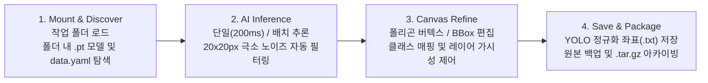

<div align="center">

# Universal Dataset Studio & Polygon Lab

**One local workspace for AI segmentation inference, interactive polygon refinement, and automated dataset curation.**

세그멘테이션 의사라벨(Pseudo-label) 추론, 인터랙티브 폴리곤·BBox 정밀 편집, 20px 극소 노이즈 정제를 단일 워크플로우로 통합한 로컬 데이터셋 구축 스튜디오입니다.

[](#quick-start)
[](#how-it-works)
[](#what-you-can-do)
[](#quick-start)
[](#)

[**Quick Start**](#quick-start) · [**How It Works**](#how-it-works) · [**What You Can Do**](#what-you-can-do) · [**Engineering Highlights**](#engineering-highlights) · [**Shortcuts**](#keyboard-shortcuts) · [**FAQ**](#faq)

```bash
./run_studio.sh
```

</div>

---

## Quick Start

### 1. 스튜디오 실행 (Web Server 또는 Native Desktop)

클론한 저장소에서 독립 웹 서버 모드(기본 포트 `8765`) 또는 GTK3/WebKit2 기반 네이티브 데스크톱 창으로 즉시 실행합니다.

```bash
# 웹 서버 모드로 실행 (http://127.0.0.1:8765)
./run_studio.sh

# 특정 데이터셋 폴더를 지정하여 네이티브 데스크톱 앱으로 즉시 열기
./launch_studio.sh /path/to/your_dataset
```

<details>
<summary><b>Debian/Ubuntu 패키지(.deb)로 시스템 전역 설치하기</b></summary>

```bash
# .deb 패키지 빌드 및 설치
./packaging/build_deb.sh
sudo dpkg -i dist/dataset-studio_1.0.0_all.deb

# 어디서든 CLI 명령어 또는 애플리케이션 런처 아이콘으로 실행
dataset-studio /path/to/your_dataset
```
</details>

### 2. 작업 폴더 내 AI 모델 배치 (Drop-in Model)

라벨링할 데이터셋 폴더 내부(루트 또는 `models/`, `weights/` 하위 폴더)에 YOLO 세그멘테이션 가중치(`.pt`)를 배치하면, 스튜디오가 이를 최우선으로 감지하여 상단 헤더에 **`[📁 작업 폴더]`** 모델로 자동 마운트합니다.

```text
your_dataset/
├── data.yaml
├── models/
│   └── custom_seg_best.pt   <-- [📁 작업 폴더] 최우선 추천 모델로 자동 선택
├── images/
│   ├── train/
│   └── val/
└── labels/
    ├── train/
    └── val/
```

### 3. AI 폴리곤 추천 및 정밀 교정

캔버스에서 이미지를 확인하며 단축키 **`R`**(또는 상단 **`🪄 AI 추천 [R]`** 버튼)을 누르면 선택된 `.pt` 모델이 즉시 세그멘테이션 폴리곤을 생성합니다. 버텍스(꼭짓점)를 드래그하여 다듬은 뒤 **`S`**(또는 **`Enter`**)로 저장합니다.

---

## How It Works

스튜디오는 로컬 파일 시스템과 인메모리 YOLO 추론 엔진, HTML5 Canvas 기하학 편집기를 직접 연결하여 외부 클라우드 업로드 없이 로컬에서 모든 데이터셋 구축 파이프라인을 처리합니다.



---

## What You Can Do

| 기능 영역 (Feature) | 스튜디오 처리 및 반환 결과 (What Studio Returns) | 요구사항 및 실행 가이드 (Requirements & Guide) |
| :--- | :--- | :--- |
| **In-Folder AI 폴리곤 추천** | 현재 이미지에 대한 YOLO-Seg 추론 수행, 다각형 단순화(`approxPolyDP`) 후 정규화 좌표(`0.0~1.0`) 레이어 즉시 병합 | 작업 폴더 또는 워크스페이스 내 `.pt` 가중치; 상단 모델 선택 후 **`R`** 키 입력 |
| **20px 극소 노이즈 차단** | 픽셀 해상도 환산 기준 가로 또는 세로 `20px` 이하 미세 파편 마스크를 추론 단계에서 자동 제외 및 데이터셋 일괄 정제 | 단일 추론 시 자동 적용; 전체 정제는 상단 마법사의 **정제 & 복제** 실행 |
| **인터랙티브 캔버스 편집** | 폴리곤 그리기(`E`), 드래그 BBox 생성(`B`), 선분 클릭 꼭짓점 추가, 우클릭 꼭짓점 삭제, 눈금자(Rulers) 및 픽셀 크기 배지 표시 | HTML5 Canvas 뷰포트; 우측 `OBJECT` 탭에서 개별 객체 가시성(`👁️`) 토글 지원 |
| **배치 의사라벨 생성 (Auto-Label)** | 대량 이미지 폴더를 대상으로 백그라운드 배치 추론을 수행하고 표준 YOLO 폴더 구조(`images/`, `labels/`, `data.yaml`) 자동 생성 | 상단 **`✨`** 버튼 ➔ **AI 자동 라벨링** 탭에서 소스 폴더, 모델, Confidence 지정 |
| **다중 모델 교차 순전파 (Cross-Pseudo)** | 도메인별 특화 전문가 모델들을 순차적으로 순전파하여 다중 클래스 통합 데이터셋 구축 | 상단 **`✨`** 버튼 ➔ **전문가 상호 순전파** 탭에서 실행 |
| **스키마 & `data.yaml` 관리** | 클래스 추가/삭제/순서 변경, 고유 색상 팔레트 지정, 영문 식별자-한글 라벨 자동 매핑 및 상위 폴더 `data.yaml` 자동 상속 | 상단 **`⚙️`** 클래스 관리 모달; 설정 파일이 없는 하위 폴더 오픈 시 상위 스키마 자동 추적 |
| **안전 격리 및 패키징** | 불량 이미지를 영구 삭제하지 않고 `excluded_images/`로 라벨과 함께 격리 이동; 완료된 데이터셋을 `.tar.gz`로 압축 | 이미지 제외 시 자동 격리; 패키징 API를 통한 아카이브 생성 |

---

## Engineering Highlights

### 1. 인메모리 모델 캐싱을 통한 200ms 단일 이미지 실시간 추론
매 추론 요청마다 디스크에서 가중치를 재로드하면 파이토치 초기화 및 I/O 병목으로 1.8초 이상의 지연이 발생합니다. `server.py`의 `LOADED_YOLO_MODELS` 인메모리 캐시 딕셔너리가 로드된 모델 인스턴스를 유지하여, 동일 모델 연속 추론 시 응답 속도를 **0.200초(200ms)** 이내로 단축했습니다.

### 2. 작업 폴더 가중치 우선순위 스코어링 (In-Folder Priority)
워크스페이스 내 다수의 `.pt` 파일 중 현재 열려 있는 데이터셋 경로(`state.dataset_path`) 내부에 위치한 모델(실제 파일 및 심볼릭 링크 모두 포함)에 대해 `+200.0`의 우선순위 가중치를 부여합니다. 클래스 호환율(`match_ratio`) 및 `mAP`(`fitness`) 지표와 결합하여 최적의 모델을 드롭다운 최상단에 자동 배치합니다.

### 3. 20×20px 미세 노이즈 필터링 및 다각형 최적화
세그멘테이션 추론 시 발생하는 미세 파편이 학습 데이터를 오염시키는 것을 막기 위해, 정규화 마스크 좌표를 원본 이미지 해상도(`img_w × img_h`)로 역산하여 바운딩 박스 크기가 `box_w <= 20.0` 또는 `box_h <= 20.0`인 객체를 원천 배제합니다. 유효 마스크는 `cv2.approxPolyDP`(`epsilon = 0.0015 * perimeter`)를 거쳐 편집 가능한 최적의 버텍스 개수로 단순화됩니다.

---

## Keyboard Shortcuts

| 단축키 | 동작 (Action) | 상세 설명 |
| :--- | :--- | :--- |
| **`R`** | **AI 폴리곤 추천 실행** | 현재 보고 있는 이미지에 대해 선택된 `.pt` 모델로 세그멘테이션 폴리곤 추천 및 병합 |
| **`E`** | **폴리곤 그리기 모드** | 다각형 수동 그리기 전환 (연속 2회 입력 시 클래스 선택 팝업 오픈) |
| **`B`** | **바운딩 박스(BBox) 모드** | 마우스 드래그로 4점 사각형 폴리곤 즉시 생성 |
| **`V`** / **`Esc`** | **선택(Select) 모드 / 취소** | 그리기 취소 및 객체/꼭짓점 선택·이동 모드로 복귀 |
| **`0` ~ `9`** | **클래스 즉시 변경** | 그리기 모드에서 해당 번호의 클래스로 즉시 전환 |
| **`Enter`** | **그리기 완료 / 검수 완료** | 폴리곤 닫기 완료, 또는 선택 모드에서 현재 이미지 검수 완료 후 다음 이미지로 이동 |
| **`S`** / **`Ctrl + S`** | **현재 라벨 저장** | 현재 캔버스의 폴리곤 변경사항을 YOLO `.txt` 파일에 즉시 기록 |
| **`Q`** / **`Del`** | **선택 폴리곤 삭제** | 현재 선택된 폴리곤 객체 제거 |
| **`A`** / **`D`** (`←` / `→`) | **이전 / 다음 이미지** | 변경사항 자동 저장 후 이전/다음 이미지로 이동 |
| **`F`** | **화면 맞춤 (Fit to Screen)** | 캔버스 줌/팬 상태를 초기화하여 이미지를 뷰포트 중앙에 맞춤 |
| **`Space + 드래그`** | **캔버스 이동 (Pan)** | 확대된 상태에서 작업 화면 자유 이동 (`마우스 휠`: 줌 인/아웃) |
| **`선분 클릭` / `우클릭`** | **꼭짓점 추가 / 삭제** | 폴리곤 선분 클릭 시 새 꼭짓점 삽입, 기존 꼭짓점 우클릭 시 해당 점 삭제 (최소 3점 유지) |

---

## FAQ

<details>
<summary><b>작업 폴더 안에 둔 .pt 모델은 어떤 기준으로 우선 인식되나요?</b></summary>

스튜디오는 현재 마운트된 데이터셋 디렉토리(`state.dataset_path`) 및 그 하위 폴더(`models/`, `weights/` 등)를 재귀 스캔합니다. 해당 경로 내부에 존재하는 `.pt` 파일(심볼릭 링크 포함)은 `is_in_folder = True`로 분류되어 스코어 `+200.0`을 부여받으며, 상단 모델 선택기 최상단 `📁 작업 폴더 내 모델` 그룹에 자동 배치됩니다.
</details>

<details>
<summary><b>이미 라벨이 있는 이미지에서 AI 추천(R)을 실행하면 기존 라벨이 덮어써지나요?</b></summary>

덮어써지지 않습니다. `triggerAiRecommend()`는 기존에 그려진 폴리곤 배열(`currentAnnotation.polygons`) 뒤에 새로 추론된 폴리곤들을 추가(Append)하고 레이어 ID를 재정렬합니다. 원치 않는 객체만 `Q` 키로 선택 삭제하거나 우측 `OBJECT` 리스트에서 제어할 수 있습니다.
</details>

<details>
<summary><b>data.yaml 파일이 없는 일반 이미지 폴더도 열 수 있나요?</b></summary>

가능합니다. 상단 `📁` 폴더 탐색기에서 일반 이미지 폴더를 열고 초기화 옵션을 선택하면 표준 YOLO 디렉토리 구조를 구성할 수 있습니다. 또한 하위 서브 폴더를 열었을 때 해당 위치에 `data.yaml`이 없더라도 상위 최대 3단계 디렉토리를 자동 탐색하여 상위 `data.yaml`의 클래스 스키마를 상속받습니다.
</details>

<details>
<summary><b>서버 포트를 변경하거나 백그라운드 로그를 확인하려면 어떻게 하나요?</b></summary>

환경 변수 `PORT`를 지정하여 실행 포트를 변경할 수 있습니다.
```bash
PORT=9000 ./run_studio.sh
```
데스크톱 런처(`launch_studio.sh`)로 실행한 경우 서버 로그는 프로젝트 루트의 `studio_server.log`에 기록됩니다.
</details>
