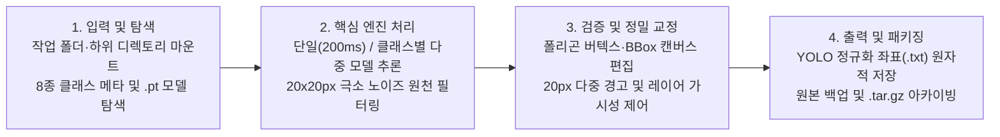

<div align="center">

# Universal Dataset Studio & Polygon Lab

**One local workspace for multi-model AI segmentation inference, interactive polygon refinement, and automated dataset curation.**

세그멘테이션 의사라벨(Pseudo-label) 다중 모델 추론, 인터랙티브 폴리곤·BBox 정밀 편집, 20px 극소 노이즈 원천 차단을 단일 워크플로우로 통합한 로컬 데이터셋 구축 스튜디오입니다.

[](#quick-start)
[](#how-it-works)
[](#capabilities)
[](#quick-start)
[](#)

[**Quick Start**](#quick-start) · [**How It Works**](#how-it-works) · [**Capabilities**](#capabilities) · [**Showcases**](#showcases) · [**Shortcuts & CLI**](#shortcuts--cli) · [**FAQ**](#faq)

```bash
./run_studio.sh
```

</div>

---

## Quick Start

### 1) 환경 구성 및 설치 (Setup)

Ubuntu 환경에서 원클릭 설치 스크립트(`setup_ubuntu.sh`)를 실행하면 가상환경(`.venv`), PyTorch/Ultralytics 의존성, 데스크톱 애플리케이션 런처가 자동으로 구성됩니다.

```bash
# Ubuntu 원클릭 의존성 및 데스크톱 런처 설치 (CPU 기본 / GPU 선택 가능)
./setup_ubuntu.sh

# GPU(CUDA) 가중치 추론 환경으로 설치할 경우
TORCH_INDEX_URL=https://download.pytorch.org/whl/cu124 ./setup_ubuntu.sh
```

<details>
<summary><b>Debian/Ubuntu 패키지(.deb)로 시스템 전역 설치하기</b></summary>

```bash
# .deb 패키지 빌드 및 설치
./packaging/build_deb.sh
sudo dpkg -i dist/dataset-studio_1.0.0_all.deb

# 어디서든 CLI 명령어 또는 애플리케이션 런처 아이콘으로 실행
dataset-studio <dataset_path>
```
</details>

### 2) 핵심 실행 (Run)

독립 웹 서버 모드 또는 GTK3/WebKit2 네이티브 데스크톱 창으로 즉시 실행합니다. 기존 포트가 사용 중일 경우 빈 로컬 포트를 자동 할당합니다.

```bash
# 웹 서버 모드로 실행 (기본 http://127.0.0.1:8765)
./run_studio.sh

# 특정 데이터셋 폴더를 지정하여 네이티브 데스크톱 앱으로 즉시 열기
./launch_studio.sh <dataset_path>
```

### 3) 작업 폴더 AI 모델 배치 및 추론 제어 (Control)

라벨링할 데이터셋 폴더 내부(루트 또는 `models/`, `weights/`)에 YOLO 가중치(`.pt`)를 배치하면 상단 헤더에 **`[📁 작업 폴더]`** 모델로 최우선 마운트됩니다. 캔버스에서 **`R`** 키를 눌러 단일 이미지 폴리곤을 즉시 생성하거나, 클래스별로 서로 다른 전문 모델을 매핑하여 일괄 추론합니다.

```text
<dataset_path>/
├── data.yaml                # 또는 classes.txt, classes.json, dataset.yaml 자동 감지
├── models/
│   └── custom_seg_best.pt   # [📁 작업 폴더] 최우선 추천 모델로 자동 마운트
├── images/
│   ├── train/
│   └── val/
└── labels/
    ├── train/
    └── val/
```

---

## How It Works

로컬 파일 시스템과 인메모리 다중 YOLO 추론 엔진, HTML5 Canvas 기하학 편집기를 직접 연결하여 외부 클라우드 업로드 없이 로컬에서 전 과정을 처리합니다.



---

## Capabilities

| 대상 / 기능 (Target / Feature) | 반환 결과 및 동작 (What It Returns) | 요구사항 및 트리거 (Requirements & Guide) |
| :--- | :--- | :--- |
| **In-Folder AI 폴리곤 추천** | 현재 이미지에 대해 YOLO-Seg 추론 수행, 다각형 단순화(`approxPolyDP`) 후 정규화 좌표(`0.0~1.0`) 레이어 즉시 병합 | 작업 폴더 또는 워크스페이스 내 `.pt` 가중치; 상단 모델 선택 후 **`R`** 키 입력 |
| **클래스별 다중 모델 매핑** | 타겟 데이터셋의 각 클래스를 서로 다른 전문 `.pt` 모델의 특정 클래스에 1:1 매핑하여 교차 의사라벨링(Cross Pseudo-Labeling) 수행 | 단일 이미지 추천 모달 또는 새 데이터셋 마법사의 **`클래스별 모델 매핑`** 설정 |
| **8종 포맷 동적 클래스 로더** | `classes_meta.json`, `data.yaml`, `dataset.yaml`, `classes.txt`, `labels.txt`, `names.txt`, `classes.json` 및 상위 폴더 스키마 자동 상속 | 폴더 열기 시 자동 감지; 우측 **`[⚙️ 관리]`** 모달에서 프리셋 로드 및 `data.yaml` 즉시 저장 |
| **20px 극소 노이즈 원천 차단** | 원본 픽셀 환산 기준 가로 또는 세로 `20px` 이하 미세 파편 생성을 그리기·편집·추론 전 단계에서 차단 및 시각 경고 배지 표시 | 수동 편집 및 AI 추론 시 상시 작동; 기존 데이터셋은 **`정제 & 복제`** 마법사로 일괄 정제 |
| **전문 2D 캔버스 편집기** | 폴리곤 그리기(`E`), 드래그 BBox(`B`), 선분 클릭 꼭짓점 추가, 우클릭 꼭짓점 삭제, 눈금자(Rulers) 및 실시간 픽셀 치수 배지 렌더링 | HTML5 Canvas 뷰포트; 우측 `OBJECT` 탭에서 개별 객체 가시성(`👁️`) 토글 및 클래스 즉시 변경 |
| **원자적 저장 및 백업 패키징** | Thread Lock + 임시 파일 교체(`os.replace`) 기반 무손실 라벨 기록, 원본 백업(`labels_backup/`) 및 `.tar.gz` 아카이브 생성 | **`S`** 또는 **`Enter`** 입력 시 즉시 반영; 상단 **`📦 패키지 내보내기`** 지원 |

---

## Showcases

### 1. 인메모리 다중 모델 캐싱을 통한 추론 지연 89% 단축 (`1.8s → 200ms`)
- **문제**: 단일 이미지 검수 중 AI 추천(`R`)을 호출할 때마다 디스크에서 `.pt` 체크포인트를 재로드하여 약 `1.5~1.8초`의 지연이 발생함.
- **해결 및 정량 지표**: 백엔드(`server.py`)에 최대 3개의 `YOLO(model_path)` 인스턴스를 유지하는 LRU 인메모리 캐시(`_RUNTIME_YOLO_MODELS`)를 구축하여, 단일 모델 및 클래스별 다중 모델 연속 추론 시 응답 속도를 **`0.200초(200ms)`** 이내로 단축했습니다.

### 2. 작업 폴더 가중치 우선 스코어링 (`+200.0`) 및 클래스 호환성 자동 매칭
- **문제**: 워크스페이스 내 수십 개의 가중치 파일이 혼재되어 현재 데이터셋에 맞는 모델을 수동으로 찾기 어려움.
- **해결 및 정량 지표**: `.pt` 체크포인트 헤더에서 지원 클래스(`names`), 클래스 수(`nc`), 검증 `mAP`(`best_fitness`)를 추출해 mtime 기반으로 캐싱(응답 `< 0.6초`)하고, 현재 작업 폴더 내부 모델에 `+200.0` 가중치를 부여하여 최적 모델을 1위로 자동 선택합니다.

### 3. 20×20px 극소 노이즈 원천 배제 및 다각형 버텍스 최적화
- **문제**: 세그멘테이션 추론 시 소실점 부근에 생성되는 20px 미만의 미세 파편이 백본 특징맵을 오염시키고 수기 교정 시간을 증가시킴.
- **해결 및 정량 지표**: 정규화 좌표를 원본 해상도(`img_w × img_h`)로 역산하여 `box_w <= 20.0` 또는 `box_h <= 20.0`인 파편을 **100% 자동 필터링**하고, 유효 마스크는 `cv2.approxPolyDP`(`epsilon = 0.0015 * perimeter`)로 단순화하여 편집 가능한 최적 꼭짓점 수를 유지합니다.

---

## Shortcuts & CLI

### 캔버스 조작 단축키

| 단축키 | 동작 (Action) | 상세 설명 |
| :--- | :--- | :--- |
| **`R`** | **AI 폴리곤 추천 실행** | 현재 이미지에 대해 선택된 `.pt` 모델(또는 클래스별 매핑 모델)로 폴리곤 추론 및 병합 |
| **`E`** | **폴리곤 그리기 모드** | 다각형 수동 그리기 전환 (연속 2회 입력 시 클래스 선택 팝업 오픈) |
| **`B`** | **바운딩 박스(BBox) 모드** | 마우스 드래그로 4점 사각형 폴리곤 즉시 생성 (20px 이하 자동 차단) |
| **`V`** / **`Esc`** | **선택(Select) 모드 / 취소** | 그리기 취소 및 객체/꼭짓점 선택·이동 모드로 복귀 |
| **`0` ~ `9`** | **클래스 즉시 변경** | 선택된 폴리곤 또는 그리기 모드의 클래스를 해당 번호로 즉시 전환 |
| **`Enter`** | **그리기 완료 / 검수 완료** | 폴리곤 닫기 완료, 또는 선택 모드에서 현재 이미지 검수 완료 후 다음 이미지로 이동 |
| **`S`** / **`Ctrl + S`** | **현재 라벨 저장** | 현재 캔버스의 폴리곤 변경사항을 YOLO `.txt` 파일에 원자적으로 기록 |
| **`Q`** / **`Del`** | **선택 폴리곤 삭제** | 현재 선택된 폴리곤 객체 제거 |
| **`A`** / **`D`** (`←` / `→`) | **이전 / 다음 이미지** | 변경사항 자동 저장 후 이전/다음 이미지로 이동 |
| **`F`** | **화면 맞춤 (Fit to Screen)** | 캔버스 줌/팬 상태를 초기화하여 이미지를 뷰포트 중앙에 맞춤 |
| **`Space + 드래그`** | **캔버스 이동 (Pan)** | 확대된 상태에서 작업 화면 자유 이동 (`마우스 휠`: 줌 인/아웃) |
| **`선분 클릭` / `우클릭`** | **꼭짓점 추가 / 삭제** | 폴리곤 선분 클릭 시 새 꼭짓점 삽입, 기존 꼭짓점 우클릭 시 해당 점 삭제 (최소 3점 유지) |

### 실행 스크립트 및 환경 변수

| 명령 / 환경 변수 | 기본값 | 설명 |
| :--- | :--- | :--- |
| `./run_studio.sh` | `PORT=8765` | 브라우저 기반 웹 서버 모드로 스튜디오 실행 |
| `./launch_studio.sh [path]` | 자동 빈 포트 | GTK3/WebKit2 네이티브 데스크톱 창으로 스튜디오 실행 및 지정 폴더 오픈 |
| `PORT=<number>` | `8765` | 웹 서버 바인딩 포트 수동 지정 (예: `PORT=9000 ./run_studio.sh`) |
| `DATASET_STUDIO_HOME` | `~/.local/share/dataset-studio` | 최근 작업 이력 및 런타임 설정 저장 경로 지정 |

---

## FAQ

<details>
<summary><b>작업 폴더 안에 둔 .pt 모델은 어떤 기준으로 우선 인식되나요?</b></summary>

스튜디오는 현재 마운트된 데이터셋 디렉토리(`state.dataset_path`) 및 그 하위 폴더(`models/`, `weights/` 등)를 재귀 스캔합니다. 해당 경로 내부에 존재하는 `.pt` 파일(심볼릭 링크 포함)은 `is_in_folder = True`로 분류되어 스코어 `+200.0`을 부여받으며, 상단 모델 선택기 최상단 `📁 작업 폴더 내 모델` 그룹에 자동 배치됩니다.
</details>

<details>
<summary><b>서로 다른 클래스를 감지하는 여러 개의 .pt 모델을 동시에 사용할 수 있나요?</b></summary>

가능합니다. 단일 이미지 AI 추천 설정 또는 새 데이터셋 마법사에서 **`클래스별 모델 매핑(Class Model Map)`** 기능을 활성화하면, 데이터셋의 각 클래스마다 사용할 `.pt` 모델과 원본 모델의 클래스 이름을 개별 지정하여 한 번에 병합 추론할 수 있습니다.
</details>

<details>
<summary><b>이미 라벨이 있는 이미지에서 AI 추천(R)을 실행하면 기존 라벨이 덮어써지나요?</b></summary>

덮어써지지 않습니다. `triggerAiRecommend()`는 기존에 그려진 폴리곤 배열(`currentAnnotation.polygons`) 뒤에 새로 추론된 폴리곤들을 추가(Append)하고 레이어 ID를 재정렬합니다. 원치 않는 객체만 `Q` 키로 선택 삭제하거나 우측 `OBJECT` 리스트에서 제어할 수 있습니다.
</details>

<details>
<summary><b>data.yaml 파일이 없는 일반 이미지 폴더나 하위 train/ 폴더만 열어도 클래스가 인식되나요?</b></summary>

인식됩니다. 현재 폴더에 `data.yaml`이 없더라도 `classes_meta.json`, `dataset.yaml`, `classes.txt`, `labels.txt`, `names.txt`, `classes.json`을 순차 탐색하며, 상위 디렉토리의 `data.yaml`까지 자동 상속합니다. 또한 우측 사이드바의 **`[⚙️ 관리]`** 모달에서 클래스를 직접 정의하고 `data.yaml`로 즉시 저장할 수 있습니다.
</details>
